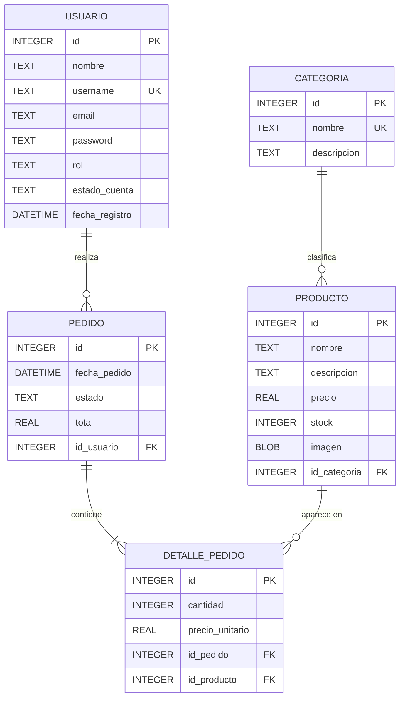

# DER — Diagrama Entidad-Relación de Ruffcol

Base de datos: **SQLite** (`ruffcol.db`) para la implementación activa Node.js.
Existe un equivalente MySQL para la implementación Java/Spring Boot en [04_esquema_mysql.sql](04_esquema_mysql.sql).

---

## 1. Diagrama (Mermaid)

> GitHub y la mayoría de visores Markdown renderizan este diagrama automáticamente.



### Representación textual

```
USUARIO (1) ─────< PEDIDO (N)
CATEGORIA (1) ───< PRODUCTO (N)
PEDIDO (1) ──────< DETALLE_PEDIDO (N)
PRODUCTO (1) ────< DETALLE_PEDIDO (N)
```

- Un **usuario** puede realizar muchos **pedidos** (1:N).
- Una **categoría** agrupa muchos **productos** (1:N).
- Un **pedido** contiene una o varias líneas en **detalle_pedido** (1:N).
- Un **producto** puede aparecer en muchos **detalles** (1:N).

---

## 2. Diccionario de datos

### 2.1 `usuario`

| Columna | Tipo SQLite | Nulo | Clave | Descripción |
|---|---|---|---|---|
| `id` | INTEGER | No | PK, autoincremental | Identificador |
| `nombre` | TEXT | No | — | Nombre completo |
| `username` | TEXT | No | UK | Nombre de usuario único |
| `email` | TEXT | Sí | — | Correo electrónico |
| `password` | TEXT | No | — | Hash bcrypt de la contraseña |
| `rol` | TEXT | No | — | `CLIENTE`, `ADMIN` o `SUPER_ADMIN` |
| `estado_cuenta` | TEXT | No | — | `ACTIVO`, `PENDIENTE` o `INACTIVO` |
| `fecha_registro` | DATETIME | Sí | — | Alta del usuario (`CURRENT_TIMESTAMP`) |

### 2.2 `categoria`

| Columna | Tipo SQLite | Nulo | Clave | Descripción |
|---|---|---|---|---|
| `id` | INTEGER | No | PK, autoincremental | Identificador |
| `nombre` | TEXT | No | UK | Nombre único de la categoría |
| `descripcion` | TEXT | Sí | — | Detalle de la categoría |

### 2.3 `producto`

| Columna | Tipo SQLite | Nulo | Clave | Descripción |
|---|---|---|---|---|
| `id` | INTEGER | No | PK, autoincremental | Identificador |
| `nombre` | TEXT | No | — | Nombre del producto |
| `descripcion` | TEXT | Sí | — | Descripción |
| `precio` | REAL | No | — | Precio unitario |
| `stock` | INTEGER | No | — | Unidades disponibles |
| `imagen` | BLOB | Sí | — | Imagen binaria (la API la entrega en Base64) |
| `id_categoria` | INTEGER | No | FK → `categoria.id` | Categoría a la que pertenece |

### 2.4 `pedido`

| Columna | Tipo SQLite | Nulo | Clave | Descripción |
|---|---|---|---|---|
| `id` | INTEGER | No | PK, autoincremental | Identificador |
| `fecha_pedido` | DATETIME | No | — | Fecha y hora del pedido |
| `estado` | TEXT | No | — | `PENDIENTE`, `EN_CONFECCION`, `ENVIADO` o `ENTREGADO` |
| `total` | REAL | No | — | Suma de subtotales calculada en el servidor |
| `id_usuario` | INTEGER | No | FK → `usuario.id` | Cliente que realizó el pedido |

### 2.5 `detalle_pedido`

| Columna | Tipo SQLite | Nulo | Clave | Descripción |
|---|---|---|---|---|
| `id` | INTEGER | No | PK, autoincremental | Identificador |
| `cantidad` | INTEGER | No | — | Unidades del producto |
| `precio_unitario` | REAL | No | — | Precio del producto al momento de la compra |
| `id_pedido` | INTEGER | No | FK → `pedido.id` | Pedido al que pertenece la línea |
| `id_producto` | INTEGER | No | FK → `producto.id` | Producto de la línea |

---

## 3. Restricciones e integridad

- **Claves primarias:** todas las tablas usan `INTEGER PRIMARY KEY AUTOINCREMENT` (en MySQL, `INT AUTO_INCREMENT`).
- **Unicidad:** `usuario.username` y `categoria.nombre`.
- **Claves foráneas:** declaradas en `producto`, `pedido` y `detalle_pedido`. SQLite requiere `PRAGMA foreign_keys = ON` por conexión para hacerlas cumplir; el servidor actual no lo activa.
- **Borrado:** la API elimina primero los `detalle_pedido` y luego el `pedido` (borrado manual en cascada). Eliminar una categoría con productos o un usuario con pedidos fallaría si las FK estuvieran forzadas.
- **Estados:** se almacenan como texto; la validación de valores la hace la aplicación (actualmente no valida todos los cambios).

---

## 4. Scripts relacionados

| Archivo | Propósito |
|---|---|
| [01_esquema_sqlite.sql](01_esquema_sqlite.sql) | DDL completo para SQLite (implementación activa) |
| [02_datos_iniciales.sql](02_datos_iniciales.sql) | Categorías de prueba + super administrador |
| [03_consultas_utiles.sql](03_consultas_utiles.sql) | Consultas de verificación y reportes |
| [04_esquema_mysql.sql](04_esquema_mysql.sql) | Equivalente MySQL 8 para la versión Spring Boot |

### Recrear la base de datos desde cero

```bash
cd ruffcol-nodejs-backend
rm ruffcol.db                     # solo si se desea reiniciar los datos
sqlite3 ruffcol.db < ../Documentaciones/BaseDatos/01_esquema_sqlite.sql
sqlite3 ruffcol.db < ../Documentaciones/BaseDatos/02_datos_iniciales.sql
npm start
```

> Alternativa sin `sqlite3` CLI: basta con borrar `ruffcol.db` y ejecutar `npm start`; `server.js` crea las tablas y siembra los datos automáticamente.
