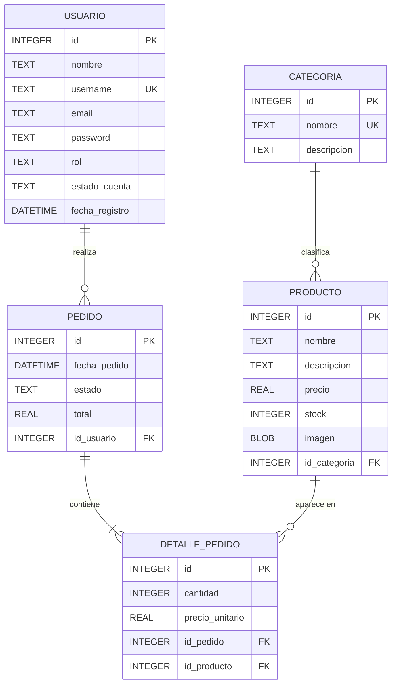

# Ruffcol — Tienda de Ropa y Accesorios para Mascotas

Sistema de comercio electrónico para la gestión de una tienda de ropa y accesorios para mascotas.

| Implementación | Estado | Stack | Puertos |
|---|---|---|---|
| **Node.js + React** | ✅ Activa (recomendada) | Express + SQLite + React 18 + Vite | Backend `3000` · Frontend `5173` |
| Java / Spring Boot | 🗄️ Original (legado) | Spring Boot 3 + JPA + H2/MySQL + HTML/JS | `8094` |

---

## 📋 Requisitos

### Opción activa (Node.js + React)
- **Node.js 18+** (probado con Node 24) y npm.
- Puertos **3000** y **5173** libres.

### Opción legado (Java)
- **JDK 17+**, **Maven 3.6+**.
- MySQL 8+ solo si se usa MySQL (por defecto H2 embebido, no requiere instalación).

---

## 🚀 Instalación y ejecución — Opción 1: Node.js + React (activa)

### 1. Backend

```bash
cd ruffcol-nodejs-backend
npm install        # solo la primera vez
npm start          # producción local
# npm run dev      # desarrollo con recarga automática (nodemon)
```

- Servidor: **http://localhost:3000**
- Al arrancar crea `ruffcol.db` (SQLite) si no existe, con las tablas, 3 categorías de prueba y el super administrador.
- Salida esperada: `Conectado a la base de datos SQLite` y `Servidor Node.js corriendo en http://localhost:3000`.

### 2. Frontend

```bash
cd ruffcol-react-frontend
npm install        # solo la primera vez
npm run dev
```

- Aplicación: **http://localhost:5173**
- El frontend consume la API en `http://localhost:3000`; Vite también tiene proxy `/api → localhost:3000`.

### 3. Verificación rápida

```bash
curl http://localhost:3000/api/productos
curl http://localhost:3000/api/categorias

curl -X POST http://localhost:3000/api/auth/login \
  -H "Content-Type: application/json" \
  -d '{"username":"superadmin","password":"admin123"}'
```

### 4. Credenciales (activa)

| Usuario | Contraseña | Rol |
|---|---|---|
| `superadmin` | `admin123` | SUPER_ADMIN |

Los clientes se registran desde `/register`. Los administradores se crean desde el panel del super admin.

### 5. Recrear la base de datos (opcional)

```bash
cd ruffcol-nodejs-backend
rm ruffcol.db
sqlite3 ruffcol.db < ../Documentaciones/BaseDatos/01_esquema_sqlite.sql
sqlite3 ruffcol.db < ../Documentaciones/BaseDatos/02_datos_iniciales.sql
npm start
```

Sin el CLI de SQLite basta con borrar `ruffcol.db` y ejecutar `npm start`: el servidor crea el esquema y siembra los datos automáticamente.

---

## 🗄️ Instalación y ejecución — Opción 2: Java / Spring Boot (legado)

### 1. Ejecutar

```bash
cd ruffcol-backend
mvn clean install
mvn spring-boot:run
```

### 2. Acceder

- Tienda: **http://localhost:8094/index.html**
- Login: **http://localhost:8094/login.html**
- Registro: **http://localhost:8094/registro.html**
- Swagger: **http://localhost:8094/swagger-ui.html**
- Consola H2: **http://localhost:8094/h2-console**

### 3. Usuarios semilla (legado)

| Rol | Usuario | Contraseña |
|---|---|---|
| Super Admin | `superadmin` | `password` |
| Cliente | `Cliente_Prueba` | `Waos123_cliente` |
| Admin | `Admin_Principal` | `D4Clt//waos//tf2?` |

> Ojo: la contraseña del super admin **legado** es `password`; la del super admin de la **implementación Node** es `admin123`.

### 4. Base de datos (legado)

Por defecto usa **H2 persistente** en `./data/ruffcol_db` (usuario `sa`, sin contraseña). Los datos no se borran al reiniciar.

Para usar MySQL, comentar las líneas de H2 en `ruffcol-backend/src/main/resources/application.properties` y configurar:

```properties
spring.datasource.url=jdbc:mysql://localhost:3306/ruffcol_db?createDatabaseIfNotExist=true&useSSL=false&serverTimezone=UTC
spring.datasource.username=root
spring.datasource.password=tu_password
spring.datasource.driver-class-name=com.mysql.cj.jdbc.Driver
spring.jpa.properties.hibernate.dialect=org.hibernate.dialect.MySQLDialect
```

También existe el esquema equivalente en [Documentaciones/BaseDatos/04_esquema_mysql.sql](Documentaciones/BaseDatos/04_esquema_mysql.sql).

---

## 🛠️ Solución de problemas

| Problema | Solución |
|---|---|
| El backend no inicia | Verificar que el puerto 3000 esté libre y haber ejecutado `npm install`; revisar la consola. |
| El frontend no carga | Verificar el puerto 5173 y que el backend esté corriendo en 3000. |
| Error de conexión frontend ↔ backend | Confirmar ambos servicios activos; revisar el proxy en `vite.config.js` y el CORS del backend (`http://localhost:5173`). |
| "Credenciales inválidas" | En la app Node usar `admin123`; en la app Java usar `password`. |
| Cambiar el puerto del legado | Editar `server.port` en `application.properties` (p. ej. `8081`). |
| Los datos del legado no persisten | Asegurar `jdbc:h2:file:./data/ruffcol_db` (no `mem:`). |

---

## 📁 Estructura del repositorio

```
RUFCo Pagina/
├── ruffcol-nodejs-backend/       # API REST: Express + SQLite (activo)
│   ├── server.js                 # Servidor, rutas, JWT y esquema de BD
│   ├── check-db.js               # Utilidad de inspección de la BD
│   └── ruffcol.db                # BD local generada (no versionada)
├── ruffcol-react-frontend/       # SPA React + Vite (activo)
│   └── src/
│       ├── components/           # Home, Login, Register, Cart, MyOrders,
│       │                         # AdminDashboard, SuperAdminDashboard, Navbar
│       ├── context/AuthContext.jsx
│       ├── App.jsx               # Rutas y protección por rol
│       └── main.jsx
├── ruffcol-backend/              # Implementación original Spring Boot (legado)
├── Documentaciones/
│   ├── BaseDatos/                # Scripts SQL del modelo de datos
│   └── Ciclo_Scrum_Ruffcol.pdf
└── README.md
```

---

## 👥 Roles y permisos

| Funcionalidad | CLIENTE | ADMIN | SUPER_ADMIN |
|---|:---:|:---:|:---:|
| Catálogo, búsqueda y filtro por categoría | ✅ | ✅ | ✅ |
| Registro e inicio de sesión | ✅ | ✅ | ✅ |
| Carrito y creación de pedidos | ✅ | ✅ | ✅ |
| Consultar pedidos propios | ✅ | ✅ | ✅ |
| CRUD de categorías y productos | — | ✅ | ✅ |
| Ver todos los pedidos y cambiar estado | — | ✅ | ✅ |
| Eliminar pedidos | — | ✅ | ✅ |
| Listar y crear administradores | — | — | ✅ |

**Estados de pedido:** `PENDIENTE` → `EN_CONFECCION` → `ENVIADO` → `ENTREGADO`.
**Estados de cuenta:** `ACTIVO`, `PENDIENTE`, `INACTIVO`.

---

## 🔌 API REST

Base (implementación activa): `http://localhost:3000`

### Autenticación
| Método | Ruta | Acceso | Descripción |
|---|---|---|---|
| POST | `/api/auth/login` | Público | Devuelve JWT (24 h) y datos del usuario |
| POST | `/api/auth/register-cliente` | Público | Registra un cliente |

### Categorías
| Método | Ruta | Acceso |
|---|---|---|
| GET | `/api/categorias` | Público |
| POST | `/api/categorias` | ADMIN, SUPER_ADMIN |
| PUT | `/api/categorias/:id` | ADMIN, SUPER_ADMIN |
| DELETE | `/api/categorias/:id` | ADMIN, SUPER_ADMIN |

### Productos
| Método | Ruta | Acceso |
|---|---|---|
| GET | `/api/productos` | Público |
| GET | `/api/productos/:id` | Público |
| GET | `/api/productos/categoria/:id` | Público |
| POST | `/api/productos` | ADMIN, SUPER_ADMIN (multipart, campo `imagen`) |
| PUT | `/api/productos/:id` | ADMIN, SUPER_ADMIN (multipart) |
| DELETE | `/api/productos/:id` | ADMIN, SUPER_ADMIN |

### Pedidos
| Método | Ruta | Acceso |
|---|---|---|
| GET | `/api/pedidos` | ADMIN, SUPER_ADMIN |
| GET | `/api/pedidos/mis-pedidos` | Autenticado |
| POST | `/api/pedidos` | Autenticado (`{ items: [{ productoId, cantidad }] }`) |
| PUT | `/api/pedidos/:id/estado?estado=ENVIADO` | ADMIN, SUPER_ADMIN |
| DELETE | `/api/pedidos/:id` | ADMIN, SUPER_ADMIN |

### Super Admin
| Método | Ruta | Acceso |
|---|---|---|
| GET | `/api/superadmin/administradores` | SUPER_ADMIN |
| POST | `/api/superadmin/crear-admin` | SUPER_ADMIN |

---

## 🗄️ Modelo de datos

SQLite (activa) con 5 entidades. Equivalente MySQL en [04_esquema_mysql.sql](Documentaciones/BaseDatos/04_esquema_mysql.sql).



**Relaciones (1:N):** categoría→producto · usuario→pedido · pedido→detalle_pedido · producto→detalle_pedido.

**Reglas de negocio**
- Un producto siempre pertenece a una categoría; un pedido siempre tiene un usuario; un detalle siempre tiene pedido y producto.
- El stock no puede ser negativo y debería validarse antes de comprar (la versión actual no lo descuenta).
- `precio_unitario` en `detalle_pedido` conserva el precio al momento de la compra.
- Contraseñas siempre como hash bcrypt; nunca en texto plano.

**Scripts**
| Archivo | Propósito |
|---|---|
| [01_esquema_sqlite.sql](Documentaciones/BaseDatos/01_esquema_sqlite.sql) | DDL para SQLite |
| [02_datos_iniciales.sql](Documentaciones/BaseDatos/02_datos_iniciales.sql) | Categorías y superadmin de prueba |
| [03_consultas_utiles.sql](Documentaciones/BaseDatos/03_consultas_utiles.sql) | Consultas de verificación y reportes |
| [04_esquema_mysql.sql](Documentaciones/BaseDatos/04_esquema_mysql.sql) | Equivalente MySQL para el legado |

---

## 🧪 Utilidades

```bash
cd ruffcol-nodejs-backend
node check-db.js        # inspeccionar tablas y registros
```

---

## ⚠️ Notas técnicas

- `JWT_SECRET` y la ruta de la BD están hardcodeados en `server.js`; en producción usar variables de entorno.
- La creación de pedidos no descuenta stock ni es transaccional.
- Las imágenes de productos se guardan como `BLOB` y la API las devuelve en Base64.
- `ruffcol.db` y `node_modules/` no se versionan; la BD se regenera al iniciar el backend.
- La implementación Java se conserva como referencia y no es necesaria para ejecutar la app actual.

---

## 👨‍💻 Equipo

| Nombre | Responsabilidades |
|---|---|
| Emmanuel Moreno Rueda | Categorías y Productos (backend y frontend) |
| Andres Rodriguez | Pedidos, Usuarios y Carrito (backend y frontend) |

**Licencia:** MIT.
